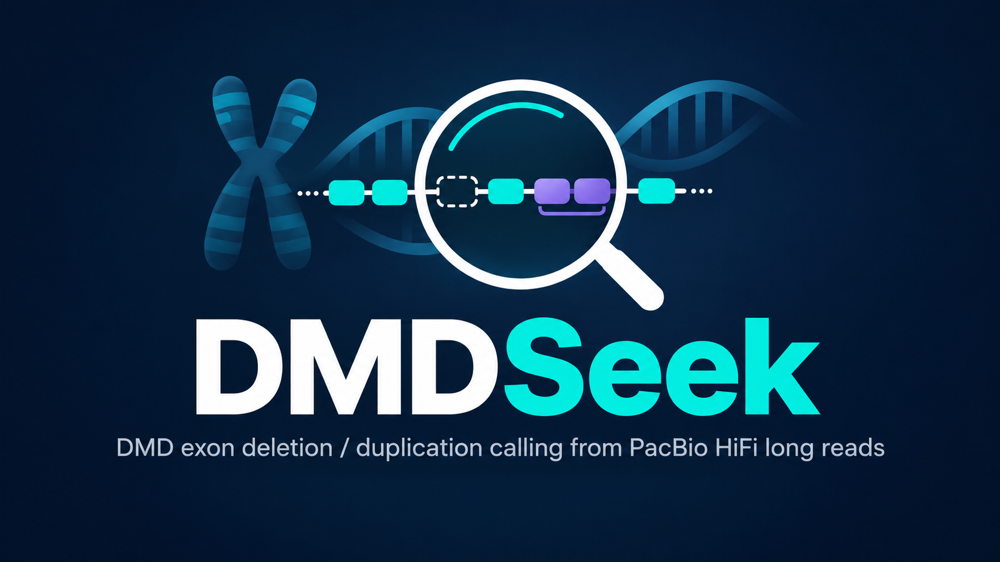

<p align="center">
  
</p>

<p align="center">
  <a href="https://github.com/CleanCham-lab/DMDSeek/releases/latest"></a>
  <a href="LICENSE"></a>
  
  
</p>

<p align="center"><a href="README.md">English</a> · <b>한국어</b> · <a href="https://github.com/CleanCham-lab/DMDSeek/releases/latest">다운로드</a></p>

BAM 하나(WGS 또는 Twist targeted)를 넣으면 고정된 기준 패널과 비교해 DMD exon 1–79의 결실·중복을 판정하고,
Sawfish breakpoint로 경계를 확정한 뒤 HTML 보고서(MLPA식 exon 그림 포함)를 만듭니다.
연구용이며, 보고 전 MLPA 등 다른 방법과 IGV로 확인해야 합니다.

## 시작 전에 (공개 배포본)

공개 배포본(`dmdseek-<버전>-linux-x86_64-public.tar.gz`)에는 프로그램만 들어 있습니다. 처음 실행 전에
아래 두 가지를 준비하면, 개발 기관에서 검증한 버전과 똑같이 동작합니다.

**1. Sawfish 설치** (breakpoint 분석 도구, 별도 라이선스라 포함하지 않음)

```bash
conda install -c bioconda sawfish      # sawfish 2.2.1에서 검증
```

PATH에 있으면 자동으로 찾습니다(또는 `--sawfish 경로`). 없으면 depth만으로 판정하므로 A tier가 나오지 않고
경계도 덜 정확합니다.

**2. 자기 코호트로 기준 패널 만들기**

판정은 각 샘플을 기준 패널과 비교해서 하므로, 패널은 같은 종류의 데이터(같은 시퀀싱 chemistry, targeted는
같은 capture 설계·프로토콜)로 만들어야 합니다.

| 데이터 | 최소 | 권장 |
|---|---|---|
| WGS | 남 8명 **그리고** 여 8명 | 성별당 20명 이상 |
| targeted capture | capture batch당 8명 | batch당 20명 이상 |

DMD 결실·중복이 있는 샘플이 섞여 있어도 됩니다(0에 가까운 구간은 자동 제외, 알려진 이벤트는
`--wgs-events` / `--target-events`로 제외).

코호트는 **샘플 시트**로 정리합니다 - CSV, TSV 또는 엑셀(.xlsx, 첫 번째 시트만 읽음).
양식: `dmdseek/templates/sample_sheet_template.csv` / `.xlsx`

| 열 | | |
|---|---|---|
| `sample_id` | 필수 | 샘플 이름 |
| `bam` | 필수 | index(.bai/.csi)가 옆에 있는 GRCh38 BAM 경로: 절대 경로, 시트 기준 상대 경로, 또는 Windows 경로(`E:\data\S1.bam` → WSL에서 `/mnt/e/data/S1.bam`로 자동 변환) |
| `sex` | 선택 | `M`/`F` (남/여도 가능). 비우면 read로 추정 (WGS는 적어주는 것 권장) |
| `batch` | 선택 | targeted capture batch/pool. batch마다 패널을 따로 만듦 |

열 이름은 대략 맞으면 됩니다("Sample ID", "BAM path", "Gender", "성별"도 인식).

```bash
./dmdseek/dmdseek build-reference --wgs-bams wgs_cohort.xlsx    -o dmdseek/reference/dmd_reference.npz   # WGS만
./dmdseek/dmdseek build-reference --target-bams tgt_cohort.csv  -o dmdseek/reference/dmd_reference.npz   # targeted만
./dmdseek/dmdseek build-reference --wgs-bams wgs_cohort.xlsx --target-bams tgt_cohort.csv \
    -o dmdseek/reference/dmd_reference.npz   # 둘 다: 한 파일에
```

`dmdseek/reference/dmd_reference.npz`로 저장하면 자동으로 쓰이고, 다른 위치면 `--reference 파일`로 지정합니다.

**3. MLPA 결과가 있는 자기 샘플로 확인** (아래 *검증* 참고)

## 실행

```bash
tar -xzf dmdseek-1.0.0-linux-x86_64-public.tar.gz   # Releases 페이지에서 다운로드
./dmdseek/dmdseek call sample.bam --ref GRCh38.fa -o results/
./dmdseek/dmdseek call *.bam --ref GRCh38.fa -o results/ -t 8      # 여러 개: 샘플별 폴더 + dmdseek_summary.tsv
./dmdseek/dmdseek call --list samples.xlsx --ref GRCh38.fa -o results/  # 샘플 시트(CSV/TSV/XLSX: sample_id, bam)
./dmdseek/dmdseek call sample.bam --ref GRCh38.fa -o results/ -target   # 자동 판별 대신 targeted로 지정 (-wgs도 가능)
./dmdseek/dmdseek -help                                                # 전체 명령, call -help는 call 옵션
```

- 입력: GRCh38(chr 표기) 정렬·index된 BAM. WGS/targeted와 성별은 자동 판별(`--mode`, `--sex`로 지정 가능)
- `--ref`(GRCh38 FASTA + .fai)를 주면 breakpoint 단계가 실행됨. 없으면 depth만 사용(최대 B tier)
- Linux x86_64 / WSL2. 위의 Sawfish와 기준 패널 외에는 설치할 것 없음

## 결과

- `<sample>.dmdseek.report.html` 결론, exon 그림, 유전자·확대 그림, 이벤트 표, QC
- `<sample>.dmdseek.events.tsv` / `.exons.tsv` / `.summary.json` / `.bins.tsv.gz`

Tier — **A** exon 포함 + CN 일치 + breakpoint 일치, **B** 검토 필요(breakpoint 없음 등), **C** intron + breakpoint,
**D** 약한 신호(표에만). *exon 검토 표시*는 판정되지 않았지만 depth가 특이한 exon(여성 소형 het 결실,
MLPA probe 위치 변이 등)입니다.

## 기준 패널

`reference/dmd_reference.npz`에는 성별·batch별 bin 요약 통계(중앙값, MAD, capture profile), exon 좌표,
코호트에서 반복된 intron 변이만 들어 있습니다. 샘플 ID와 개별 샘플 depth는 없습니다.
패널은 만든 코호트와 같은 종류의 데이터에서만 유효합니다(targeted는 같은 capture 설계·프로토콜).
`dmdseek info`로 현재 패널을 확인할 수 있고, 만드는 방법과 필요한 샘플 수는 *시작 전에*에 있습니다.

## 검증

```bash
# 정답 시트(CSV/TSV/XLSX): sample_id, type(DEL/DUP/NONE, 제외는 EXCLUDE), exons(예: 45~47)
./dmdseek/dmdseek validate --truth truth.xlsx --summary results/dmdseek_summary.tsv -o validation.tsv
```

기준을 만든 샘플을 그 기준으로 다시 판정하면 성능이 좋게 나옵니다. `tools/crossval_target.sh`는
가족 단위로 K개 fold로 나눠, 각 fold를 그 fold를 뺀 기준으로 판정합니다(새 샘플에 대한 정직한 추정).
`tools/make_lists.py`는 코호트 manifest에서 BAM 목록을 만듭니다.

## 개발

서울대학교병원 진단검사의학과 분자진단검사실 — 개발 채승원, 책임연구자 성문우 (진단검사의학과, 서울대학교 암연구소)

라이선스: MIT (`LICENSE`). 인용 정보: `CITATION.cff`.
